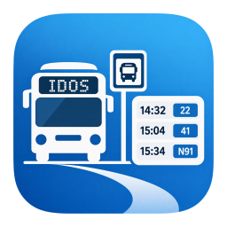
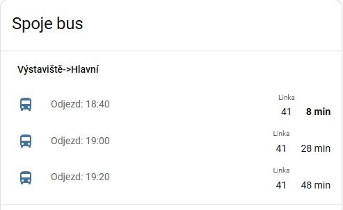

<p align="center">
  
</p>

# Odjezdy spojů IDOS

[](https://github.com/rds76/ha-odjezdy-spoju-idos/releases/latest)
[](LICENSE)

[](https://github.com/rds76/ha-odjezdy-spoju-idos/stargazers)

Home Assistant integrace pro zobrazení nadcházejících odjezdů veřejné dopravy z portálu IDOS.



Integrace je vhodná například pro sledování odjezdů z místa bydliště, pracoviště, školy nebo jiné často používané zastávky. Automaticky zobrazuje nejbližší přímé spoje mezi dvěma zvolenými zastávkami a plánuje aktualizace podle skutečných časů odjezdů.

> Tato integrace není oficiálně spojena se službou IDOS.

## Funkce

- Konfigurace přes uživatelské rozhraní Home Assistantu (Config Flow)
- Podpora více oblastí IDOS
- Zobrazení více následujících spojů
- Automatická aktualizace před odjezdem nejbližšího spoje
- Čeština a angličtina
- Optimalizovaný počet dotazů na IDOS

## Podporované oblasti

- IDS Jihomoravského kraje
- Pražská integrovaná doprava
- IDS Moravskoslezského kraje
- IDS Olomouckého kraje
- Vlaky

Další oblasti mohou být doplněny na vyžádání.

## Instalace přes HACS

1. Otevřete **HACS → Integrations**.
2. Přidejte tento repozitář jako **Custom Repository** typu **Integration**.
3. Nainstalujte integraci.
4. Restartujte Home Assistant.
5. Přidejte integraci přes **Nastavení → Zařízení a služby → Přidat integraci**.

## Ruční instalace

Zkopírujte adresář:

```text
custom_components/jr_idos
```

do:

```text
ha-config/custom_components/
```

Restartujte Home Assistant a přidejte integraci přes uživatelské rozhraní.

## Konfigurace

Při vytváření nové trasy lze nastavit:

| Položka | Popis |
|----------|----------|
| Název | Název trasy zobrazený v Home Assistantu |
| Oblast | IDS JMK, PID apod. |
| Výchozí zastávka | Nástupní zastávka |
| Cílová zastávka | Cílová zastávka |
| Počet spojů | Počet zobrazovaných následujících spojů |
| Offset | Jak dlouho před odjezdem má být spoj považován za aktuální |

### Zadávání zastávek

Názvy zastávek je nutné zadávat přesně tak, jak je používá IDOS.

Nejjednodušší je vyhledat požadované spojení přímo na webu IDOS a zkopírovat názvy zastávek z formuláře.

Pokud název zastávky neodpovídá názvu používanému IDOSem, nemusí být nalezeno žádné spojení.

> **Tip:** Ověřte si nejprve vyhledání spojení přímo v IDOSu. Pokud spojení funguje v IDOSu, bude fungovat i v integraci.

### Důležité

Integrace používá vyhledání **přímého** spojení mezi výchozí a cílovou zastávkou.

Nejlépe se hodí pro pravidelně používané trasy, například:

- domov → centrum města
- domov → práce
- domov → nádraží
- domov → škola

Příklad:

```text
Výchozí zastávka: Výstaviště
Cílová zastávka: Hlavní
```

Integrace pak zobrazuje nejbližší odjezdy z oblasti Výstaviště směrem do centra města.

## Vytvářené entity

Pro každou trasu vznikne hlavní entita:

```text
sensor.vystaviste
```

a dále entity jednotlivých spojů:

```text
sensor.vystaviste_1
sensor.vystaviste_2
sensor.vystaviste_3
...
```

Každá entita spoje obsahuje například:

- linku
- čas odjezdu
- čas příjezdu
- popis spoje
- timestamp odjezdu
- timestamp příjezdu

## Jak funguje aktualizace

Integrace nepoužívá pevný interval obnovování.

Po načtení spojů automaticky vypočítá nejvhodnější okamžik další aktualizace podle odjezdu nejbližšího spoje. Díky tomu výrazně snižuje počet požadavků vůči službě IDOS.

## Známá omezení

- Integrace využívá HTML scraping veřejně dostupných stránek IDOS.
- Změna struktury stránek IDOS může vyžadovat úpravu parseru.
- Dostupnost dat závisí na dostupnosti služby IDOS.

## Licence

Tento projekt je distribuován pod licencí MIT.
